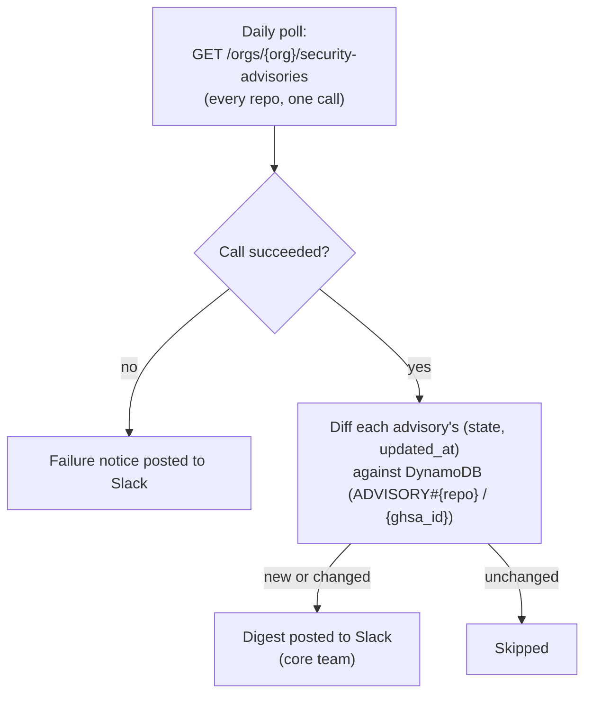

# Daily security advisory digest

GitHub's `repository_advisory` webhook doesn't reliably fire for advisories
submitted via "Report a vulnerability" (state `triage`) — no public event fires
until a maintainer or researcher formally acts on the report. That gap has let
reports sit unnoticed (e.g. `nf-core/rnaseq`'s `GHSA-pq68-g636-8gwf`). Instead,
the bot polls GitHub once a day and posts anything new or changed to a private
Slack channel for the core team to review.

## How it works

- A single org-wide API call covers every repo — no per-repo loop, so a repo
  added to the org later is covered automatically.
- Each advisory's `(state, updated_at)` is compared against what was last seen
  (stored in DynamoDB); only new or changed advisories are posted. Unchanged
  advisories are silently skipped.
- If the API call itself fails (missing permission, revoked token, GitHub
  outage), that failure is posted to the same channel too, not just logged — a
  check that silently stops working is worse than a noisy failure.
- Advisory summaries are attacker-influenced (anyone can file a vulnerability
  report against any public nf-core repo), so they're mrkdwn-escaped before
  being posted, the same way externally-supplied proposal titles are escaped in
  the on-call digest (`scheduler/oncall_jobs.py`'s `_slack_link`).

Runs as a background `asyncio.Task` launched from `app.py`, following the same
pattern as the on-call scheduler (`scheduler/oncall_jobs.py`).

## On-demand summary

`/nf-core security summary` (`@core-team` only) fetches live data from GitHub
and posts a summary of every currently-open advisory across all repos, grouped
by repo — independent of the daily digest's new/changed diffing. Posted visibly
wherever the command is run (channel or DM), not ephemerally. See
[commands.md](commands.md#security-commands).

## Configuration (env vars)

| Var                | Default         | Notes                                               |
| ------------------ | --------------- | --------------------------------------------------- |
| `SECURITY_CHANNEL` | see `config.py` | Name of the private channel the digest is posted to |

## One-time setup

### GitHub — grant the token org-wide advisory access

`GITHUB_TOKEN` already needs `admin:org` for org-invite features, but reading
Triage/draft advisories org-wide additionally requires the account behind the
token to hold a specific org role: **Security manager**.

A Classic PAT needs `repository_advisories:write` scope.

Fine-grained PAT: the **"Repository security advisories"** repository permission
to **Write**, scoped to "All repositories" for the org.

If there's an issue the daily check posts an error message to Slack.

### Slack

The bot must already be a member of the private channel set via
`SECURITY_CHANNEL` (`/invite @nf-core-bot`) — it can only post to channels it
belongs to.

## Files

- `src/nf_core_bot/checks/github.py` — `list_all_org_advisories()`, the single
  GitHub API call (cursor-paginated via the `Link` header)
- `src/nf_core_bot/db/advisories.py` — DynamoDB read/write of last-seen advisory
  state (`ADVISORY#{repo}` / `{ghsa_id}`)
- `src/nf_core_bot/security/advisories.py` — the scheduler loop, diffing logic,
  and Slack posting (digest + failure notices)
- `src/nf_core_bot/commands/security/summary.py` — the `security summary` slash
  command handler
